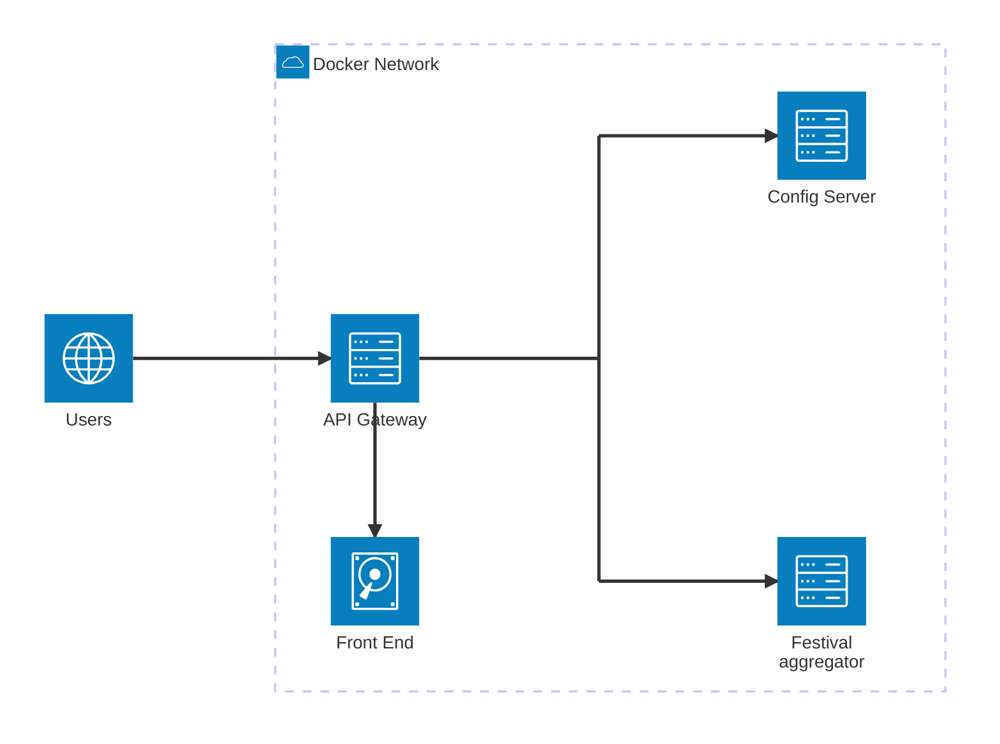

# Definitions
In this chapter is defined the semantic meaning of some expression used in the rest of
the document.

## Frontend Project
A frontend project is a TypeScript project that use [vue.js](https://vuejs.org/) 
framework. Every frontend project has its own build procedure but all the frontend 
projects defined by an architecture document are deployed together in a nginx container.

## Backend Project
A backend project is a TypeScript project that use [nestjs](https://docs.nestjs.com/) 
framework.

# Deployment Diagram

## Frontend
In the architecture diagram the frontend is the set of files obtained building the vue.js
project. The vue.js frontend project is described in the [related file](./frontend.md)

## API Gateway
The API gateway is a docker container with ngix that, on the root path, serve 
production-ready frontend files. 
The same nginx is configured to proxy the paths `/api/<microservice_id>` to
the docker container with name `microservice_id`.

## Config Server
A backend Project described in the [related file](./ms_preferencies.md)

## Festival aggregator
A backend Project described in the [related file](./ms_festival_aggregator.md)

