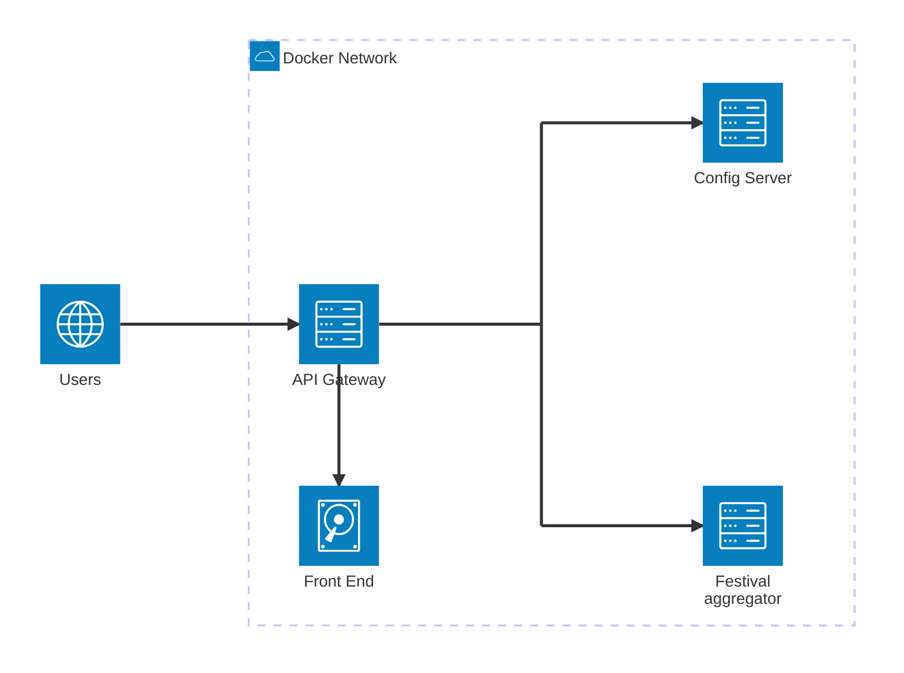

# Definitions
This chapter defines the semantic meaning of expressions used in the rest of
the document.

## Frontend Project
A frontend project is a TypeScript project that uses the [Vue.js](https://vuejs.org/) 
framework. Every frontend project has its own build procedure, but all frontend 
projects defined by an architecture document are deployed together in an Nginx container.

## Backend Project
A backend project is a TypeScript project that uses the [NestJS](https://docs.nestjs.com/) 
framework.

# Deployment Diagram

## Frontend
In the architecture diagram, the frontend is the set of files obtained by building the Vue.js
project. The Vue.js frontend project is described in the [related file](./frontend.md).

## API Gateway
The API gateway is a Docker container running Nginx that, on the root path, serves 
production-ready frontend files. 
The same Nginx instance is configured to proxy the paths `/api/<microservice_id>` to
the Docker container named `microservice_id`.

## Config Server
A backend project described in the [related file](./ms_preferences.md).

## Festival aggregator
A backend project described in the [related file](./ms_festival_aggregator.md).

